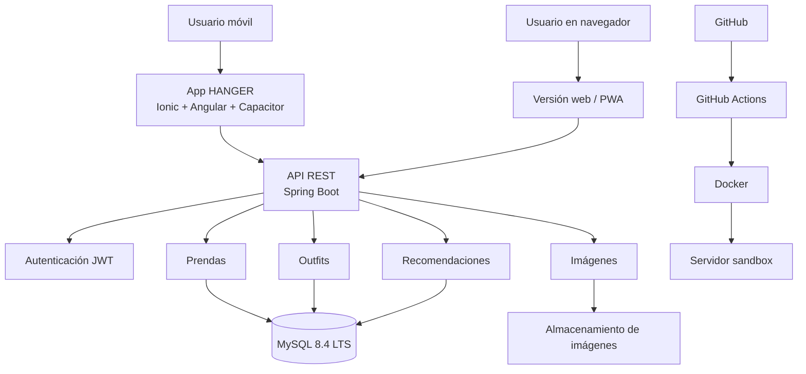

# HANGER

**Armario virtual para organizar tu ropa, crear outfits y sacar partido a las prendas que ya tienes.**

Proyecto Intermodular · 2.º DAM B · IES La Marisma (Huelva) · Curso 2026/2027
Autor: Emilio Ruiz Vázquez

> *EN: HANGER is a virtual wardrobe app (Spring Boot REST API + Ionic/Angular client + MySQL) that tracks how often each garment is worn, so users reuse, sell or donate clothes instead of buying more.*

---

## Qué problema resuelve

Mucha gente acumula ropa que apenas usa, compra por impulso y no recuerda todo lo que tiene. HANGER centraliza el armario del usuario y le ayuda a decidir mejor: qué ponerse, qué combinar y qué prendas poco usadas conviene reutilizar, vender o donar.

## Funcionalidades (MVP)

- Registro e inicio de sesión con JWT
- Alta, edición y borrado de prendas con foto, categoría, color, talla, marca, temporada y estado
- Filtros por categoría, color, temporada y etiquetas
- Creación y guardado de outfits
- Registro de uso de cada prenda y detección de prendas poco usadas
- Recomendaciones básicas de outfits basadas en reglas

## Stack

| Capa | Tecnología |
| --- | --- |
| Frontend | Ionic + Angular + Capacitor (APK Android y PWA) |
| Backend | Spring Boot · API REST · JWT · Swagger/OpenAPI |
| Base de datos | MySQL 8.4 LTS |
| DevOps | Docker · GitHub Actions · Garage (almacenamiento de imágenes compatible con S3) |
| Gestión | Scrum (sprints de 2 semanas) · GitHub Projects |

## Arquitectura



El backend se organiza en capas: controladores REST, servicios, repositorios y entidades/DTOs.

Diagrama completo: [`docs/DIAGRAMA_ARQUITECTURA.png`](docs/DIAGRAMA_ARQUITECTURA.png)

## Modelo de datos

Nueve tablas: `usuarios`, `categorias`, `prendas`, `prenda_temporada`, `etiquetas`, `prenda_etiqueta`, `outfits`, `outfit_prenda` y `uso_prenda`.

Una prenda puede valer para varias temporadas: `prenda_temporada` guarda una fila por temporada (una prenda de todo el año tiene las cuatro). La temporada de un outfit no se guarda, se calcula a partir de sus prendas.

La tabla `uso_prenda` guarda cada vez que se usa una prenda (y en qué outfit). Es la base de la detección de ropa olvidada.

- Script: [`database/schema.sql`](database/schema.sql)
- Diagrama E-R: [`docs/DIAGRAMA_ER_BBDD.png`](docs/DIAGRAMA_ER_BBDD.png)

## Planificación

Scrum con sprints de 2 semanas lectivas. El desarrollo termina en abril; mayo se reserva para la memoria y la defensa.

| Sprint | Fechas | Objetivo |
| --- | --- | --- |
| 0 | Oct–nov 2026 | Requisitos, MVP, arquitectura y modelo de datos ✅ |
| S1 | 16/11 – 29/11/2026 | Repositorio, Docker, CI y esqueleto de la API |
| S2 | 30/11 – 13/12/2026 | Registro, login y JWT |
| S3 | 14/12/2026 – 17/01/2027 | Cierre de autenticación y seguridad de rutas (incluye Navidad) |
| S4 | 18/01 – 31/01/2027 | CRUD de categorías y prendas con temporadas |
| S5 | 01/02 – 14/02/2027 | Imágenes en almacenamiento S3; app Ionic: login y navegación |
| S6 | 15/02 – 28/02/2027 | Armario virtual: listado y ficha de prenda |
| S7 | 01/03 – 14/03/2027 | Alta de prenda con foto; filtros |
| S8 | 15/03 – 04/04/2027 | Outfits (incluye Semana Santa) |
| S9 | 05/04 – 18/04/2027 | Registro de uso y prendas olvidadas |
| S10 | 19/04 – 02/05/2027 | Despliegue en sandbox, pruebas y correcciones |
| — | Mayo 2027 | Memoria final, presentación y defensa |

## Estado

🟡 **Fase de diseño completada.** Documentación, arquitectura y modelo de datos listos. Sprint S1 en curso: ya hay esqueleto de la API (Spring Boot y comprobación de salud), entorno con Docker Compose (API, MySQL y Garage) y verificación en GitHub Actions.

## Licencia

[MIT](LICENSE)

## Documentación

- [`docs/DOCUMENTO_PI_HANGER.pdf`](docs/DOCUMENTO_PI_HANGER.pdf): documento del proyecto (kickoff)

## Cómo ejecutarlo

### Requisitos

- Git.
- Docker con Docker Compose v2 (Docker Desktop en Windows y macOS).
- Bash para el script de Garage (Git Bash en Windows).
- Para compilar y probar la API sin Docker: JDK 21 (por ejemplo, Eclipse Temurin 21) con `JAVA_HOME` apuntando a él.

### Levantar la API, MySQL y Garage

```bash
git clone https://github.com/e1000i0/PI_ERV-2DAM-B.git
cd PI_ERV-2DAM-B
cp .env.example .env
```

Edita `.env` y sustituye los valores de ejemplo. Puedes generar los secretos con `openssl rand -hex 32` (secreto de Garage y clave secreta S3) y `openssl rand -hex 12` (contraseñas de MySQL). El identificador de la clave S3 es `GK` seguido de 24 caracteres hexadecimales. `.env` no se sube al repositorio.

```bash
docker compose up -d --build
./docker/garage/init.sh
```

El segundo comando crea el bucket de imágenes y la clave S3 en Garage; se puede repetir sin problema.

Comprobaciones:

```bash
curl http://localhost:8080/actuator/health
```

Debe responder `{"groups":["liveness","readiness"],"status":"UP"}`. MySQL queda en `127.0.0.1:3306` con las nueve tablas de `database/schema.sql`, y el almacenamiento S3 de Garage en `http://127.0.0.1:3900`. Los puertos solo se publican en el propio equipo.

Para parar los servicios: `docker compose down`. Los datos se conservan en volúmenes; `docker compose down -v` los borra.

### Compilar y probar la API

Desde `backend/`, con Java 21:

| Acción | Windows | Linux o macOS |
| --- | --- | --- |
| Compilar y verificar | `.\mvnw.cmd verify` | `./mvnw verify` |
| Ejecutar pruebas | `.\mvnw.cmd test` | `./mvnw test` |
| Arrancar la API | `.\mvnw.cmd spring-boot:run` | `./mvnw spring-boot:run` |

GitHub Actions ejecuta `./mvnw verify` con Java 21 en cada pull request a `main`.
