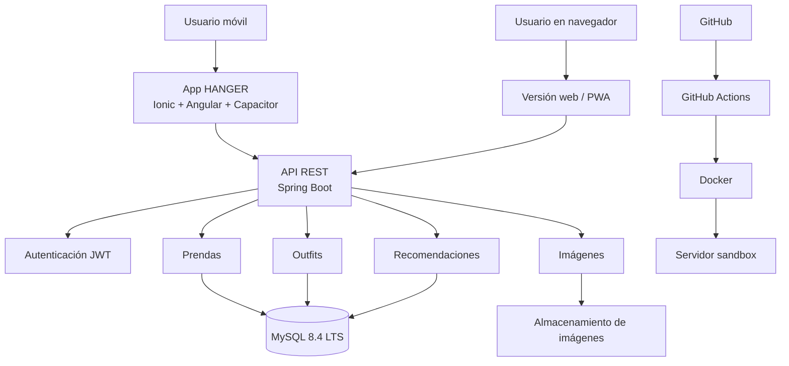

# HANGER

**Armario virtual para organizar tu ropa, crear outfits y sacar partido a las prendas que ya tienes.**

Proyecto Intermodular · 2.º DAM B · IES La Marisma (Huelva) · Curso 2026/2027
Autor: Emilio Ruiz Vázquez

> *EN: HANGER is a virtual wardrobe app (Spring Boot REST API + Ionic/Angular client + MySQL) that tracks how often each garment is worn, so users reuse, sell or donate clothes instead of buying more.*

---

## Qué problema resuelve

Mucha gente acumula ropa que apenas usa, compra por impulso y no recuerda todo lo que tiene. HANGER centraliza el armario del usuario y le ayuda a decidir mejor: qué ponerse, qué combinar y qué prendas poco usadas conviene reutilizar, vender o donar.

## Funcionalidades (MVP)

- Registro e inicio de sesión con JWT
- Alta, edición y borrado de prendas con foto, categoría, color, talla, marca, temporada y estado
- Filtros por categoría, color, temporada y etiquetas
- Creación y guardado de outfits
- Registro de uso de cada prenda y detección de prendas poco usadas
- Recomendaciones básicas de outfits basadas en reglas

## Stack

| Capa | Tecnología |
| --- | --- |
| Frontend | Ionic + Angular + Capacitor (APK Android y PWA) |
| Backend | Spring Boot · API REST · JWT · Swagger/OpenAPI |
| Base de datos | MySQL 8.4 LTS |
| DevOps | Docker · GitHub Actions · Garage (almacenamiento de imágenes compatible con S3) |
| Gestión | Scrum (sprints de 2 semanas) · GitHub Projects |

## Arquitectura

El backend se organiza en capas: controladores REST, servicios, repositorios y entidades/DTOs.

Diagrama completo: [`docs/DIAGRAMA_ARQUITECTURA.png`](docs/DIAGRAMA_ARQUITECTURA.png)

## Modelo de datos

Nueve tablas: `usuarios`, `categorias`, `prendas`, `prenda_temporada`, `etiquetas`, `prenda_etiqueta`, `outfits`, `outfit_prenda` y `uso_prenda`.

Una prenda puede valer para varias temporadas: `prenda_temporada` guarda una fila por temporada (una prenda de todo el año tiene las cuatro). La temporada de un outfit no se guarda, se calcula a partir de sus prendas.

La tabla `uso_prenda` guarda cada vez que se usa una prenda (y en qué outfit). Es la base de la detección de ropa olvidada.

- Script: [`database/schema.sql`](database/schema.sql)
- Diagrama E-R: [`docs/DIAGRAMA_ER_BBDD.png`](docs/DIAGRAMA_ER_BBDD.png)

## Planificación

Scrum con sprints de 2 semanas lectivas. El desarrollo termina en abril; mayo se reserva para la memoria y la defensa.

| Sprint | Fechas | Objetivo |
| --- | --- | --- |
| 0 | Oct–nov 2026 | Requisitos, MVP, arquitectura y modelo de datos ✅ |
| S1 | 16/11 – 29/11/2026 | Repositorio, Docker, CI y esqueleto de la API |
| S2 | 30/11 – 13/12/2026 | Registro, login y JWT |
| S3 | 14/12/2026 – 17/01/2027 | Cierre de autenticación y seguridad de rutas (incluye Navidad) |
| S4 | 18/01 – 31/01/2027 | CRUD de categorías y prendas con temporadas |
| S5 | 01/02 – 14/02/2027 | Imágenes en almacenamiento S3; app Ionic: login y navegación |
| S6 | 15/02 – 28/02/2027 | Armario virtual: listado y ficha de prenda |
| S7 | 01/03 – 14/03/2027 | Alta de prenda con foto; filtros |
| S8 | 15/03 – 04/04/2027 | Outfits (incluye Semana Santa) |
| S9 | 05/04 – 18/04/2027 | Registro de uso y prendas olvidadas |
| S10 | 19/04 – 02/05/2027 | Despliegue en sandbox, pruebas y correcciones |
| — | Mayo 2027 | Memoria final, presentación y defensa |

## Estado

🟡 **Fase de diseño completada.** Documentación, arquitectura y modelo de datos listos. El código del backend y del frontend empieza en el Sprint S1 (16/11/2026).

## Licencia

[MIT](LICENSE)

## Documentación

- [`docs/DOCUMENTO_PI_HANGER.pdf`](docs/DOCUMENTO_PI_HANGER.pdf): documento del proyecto (kickoff)

## Cómo ejecutarlo

*Se completará cuando esté listo el Sprint 1.* Objetivo: `docker compose up` levanta la API y la base de datos.
