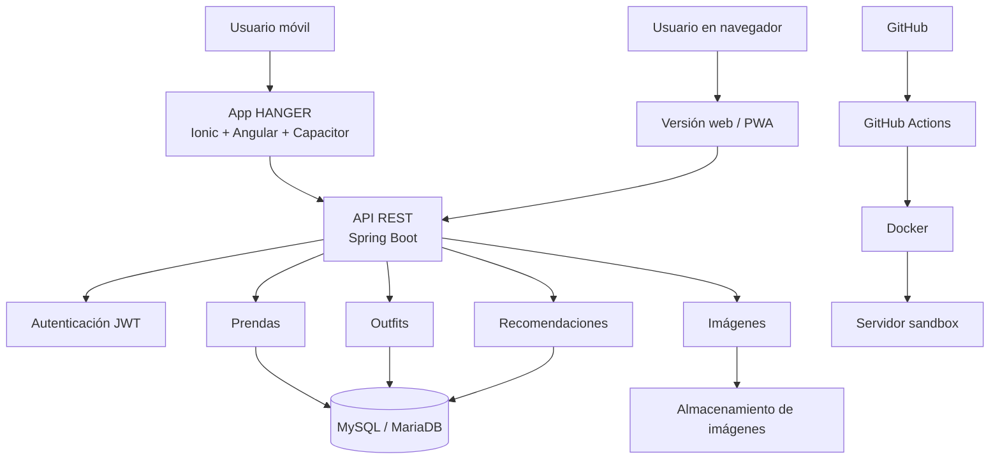

# HANGER

**Armario virtual para organizar tu ropa, crear outfits y sacar partido a las prendas que ya tienes.**

Proyecto Intermodular · 2.º DAM B · IES La Marisma (Huelva) · Curso 2026/2027
Autor: Emilio Ruiz Vázquez

> *EN: HANGER is a virtual wardrobe app (Spring Boot REST API + Ionic/Angular client + MySQL) that tracks how often each garment is worn, so users reuse, sell or donate clothes instead of buying more.*

---

## Qué problema resuelve

Mucha gente acumula ropa que apenas usa, compra por impulso y no recuerda todo lo que tiene. HANGER centraliza el armario del usuario y le ayuda a decidir mejor: qué ponerse, qué combinar y qué prendas poco usadas conviene reutilizar, vender o donar.

## Funcionalidades (MVP)

- Registro e inicio de sesión con JWT
- Alta, edición y borrado de prendas con foto, categoría, color, talla, marca, temporada y estado
- Filtros por categoría, color, temporada y etiquetas
- Creación y guardado de outfits
- Registro de uso de cada prenda y detección de prendas poco usadas
- Recomendaciones básicas de outfits basadas en reglas

## Stack

| Capa | Tecnología |
| --- | --- |
| Frontend | Ionic + Angular + Capacitor (APK Android y PWA) |
| Backend | Spring Boot · API REST · JWT · Swagger/OpenAPI |
| Base de datos | MySQL / MariaDB |
| DevOps | Docker · GitHub Actions |
| Gestión | Scrum (sprints de 2 semanas) · GitHub Projects |

## Arquitectura

El backend se organiza en capas: controladores REST, servicios, repositorios y entidades/DTOs.

Diagrama completo: [`docs/DIAGRAMA_ARQUITECTURA.png`](docs/DIAGRAMA_ARQUITECTURA.png)

## Modelo de datos

Ocho tablas: `usuarios`, `categorias`, `prendas`, `etiquetas`, `prenda_etiqueta`, `outfits`, `outfit_prenda` y `uso_prenda`.

La tabla `uso_prenda` guarda cada vez que se usa una prenda (y en qué outfit). Es la base de las estadísticas de uso y de la detección de ropa olvidada.

- Script: [`database/schema.sql`](database/schema.sql)
- Diagrama E-R: [`docs/DIAGRAMA_ER_BBDD.png`](docs/DIAGRAMA_ER_BBDD.png)

## Planificación

| Sprint | Contenido | Fechas |
| --- | --- | --- |
| 0 | Requisitos, MVP, arquitectura y modelo de datos | Oct–nov 2026 ✅ |
| 1 | Backend base, usuarios y JWT | Nov–dic 2026 |
| 2 | Prendas y categorías | Dic 2026–ene 2027 |
| 3 | App móvil base y armario virtual | Ene–feb 2027 |
| 4 | Outfits, filtros y etiquetas | Feb–mar 2027 |
| 5 | Uso de prendas, estadísticas y prendas poco usadas | Mar–abr 2027 |
| 6 | Integración, pruebas y correcciones | Abr 2027 |
| — | Memoria, presentación y defensa | Mayo 2027 |

## Estado

🟡 **Fase de diseño completada.** Documentación, arquitectura y modelo de datos listos; desarrollo del backend en curso.

## Documentación

- [`docs/DOCUMENTO_PI_HANGER.pdf`](docs/DOCUMENTO_PI_HANGER.pdf): documento del proyecto (kickoff)

## Cómo ejecutarlo

*Se completará cuando esté listo el Sprint 1.* Objetivo: `docker compose up` levanta la API y la base de datos.
